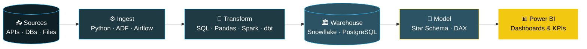

<!-- Animated header -->

  

<!-- Animated typing text -->

  

  
  
  

---

## 💫 About Me

I'm a **Data Engineer and Power BI Developer** who enjoys turning complex, messy datasets into reliable pipelines and clear, decision-ready dashboards.

- 🐍 Building data processing and automation workflows with **Python** and **Pandas**
- 🗄️ Writing optimized **SQL** (CTEs, window functions, indexing, query tuning)
- ⚙️ Designing **ETL / ELT** pipelines and learning scalable, orchestrated architectures
- 🏛️ Modeling data with **star and snowflake schemas** for analytics
- 📊 Creating interactive **Power BI** dashboards with **DAX** and **Power Query**
- 🔄 Working in **Agile** teams with Git-based collaboration
- 🌱 Continuously learning modern data tools and cloud platforms

> **Objective:** To build efficient, trustworthy data solutions that convert raw information into actionable business intelligence.

---

## 🔄 How I Work with Data

---

## 🛠️ Tech Stack

### 💻 Languages & Databases

  
  
  
  
  

### ⚙️ Data Engineering & Processing

  
  
  
  
  
  
  

### ☁️ Cloud & Data Warehousing

  
  
  
  
  

### 📊 Business Intelligence & Visualization

  
  
  
  
  

### 🔧 Tools & Methodologies

  
  
  
  
  
  
  

### 🧠 Core Concepts

| Data Engineering | Business Intelligence |
|---|---|
| Advanced SQL, CTEs & Window Functions | DAX Measures & Calculated Columns |
| Query Optimization & Indexing | Power Query (M) Transformations |
| ETL / ELT Pipeline Design | Star & Snowflake Schema Modeling |
| Data Cleaning & Validation | Row-Level Security (RLS) |
| Data Warehousing Concepts | KPI Design & Business Reporting |
| Workflow Orchestration | Interactive Dashboard Development |

---

## 📂 Featured Projects

| Project | Tech Stack | Focus |
|---|---|---|
| 🗄️ **SQL Database Management** | `MySQL` `PostgreSQL` `SQL` | Schema design, joins, window functions, query optimization |
| 🐍 **Python Data Analysis** | `Python` `Pandas` `NumPy` | Data cleaning, EDA, and automation |
| 📊 **Business Intelligence Dashboard** | `Power BI` `DAX` `Power Query` | Interactive reporting and KPI tracking |
| ⚙️ **ETL / Data Transformation Pipeline** | `SQL` `Python` | Extraction, transformation, and loading workflows |

> 🔎 Browse my [repositories](https://github.com/komalrofficial?tab=repositories) for SQL practice, analytics projects, and dashboards.

---

## 📊 GitHub Stats

  
  

  

  

---

## 🤝 Let's Connect

I'm always open to connecting with data professionals, developers, and technology enthusiasts to exchange ideas and collaborate.

  
  
  

---

  <b>💡 Turning Data Into Insights | Building Solutions Through Technology 🚀</b>

  

  <i>Thanks for visiting my profile! ⭐</i>

